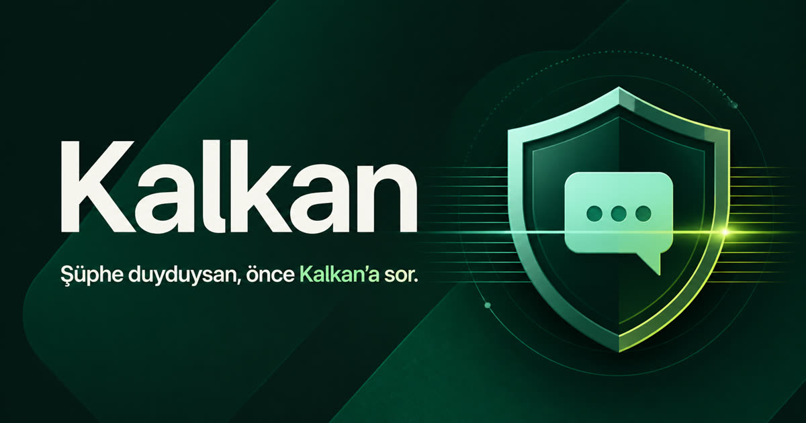

# Kalkan

<p align="center">
  
</p>

<p align="center">
  <a href="https://github.com/Nurettin-Erdogan/kalkan/actions/workflows/ci.yml"></a>
  <a href="https://github.com/Nurettin-Erdogan/kalkan/actions/workflows/codeql.yml"></a>
  <a href="https://github.com/Nurettin-Erdogan/kalkan/actions/workflows/live-check.yml"></a>
  <a href="https://nurettin-erdogan.github.io/kalkan/"></a>
  <a href="LICENSE"></a>
  
</p>

**Şüpheli mesaj, bağlantı ve ekran görüntülerindeki dolandırıcılık işaretlerini açıklanabilir kurallarla analiz et.**

Kalkan; phishing, sahte kargo/banka mesajları, taklit alan adları ve şüpheli destek hattı kalıpları gibi sinyalleri inceleyen **gizlilik odaklı, tarayıcı içinde çalışan bir risk analiz uygulamasıdır**. Mesaj ve görsel içeriği analiz için uzak bir sunucuya gönderilmez.

Kalkan bir LLM sohbet botu değildir. Sonucu tek bir "AI kararı" olarak vermek yerine, hangi sinyallerin puanı yükselttiğini kullanıcıya açıkça gösteren **kural tabanlı ve açıklanabilir** bir yaklaşım kullanır.

<p align="center">
  <a href="https://nurettin-erdogan.github.io/kalkan/"><strong>Canlı demoyu aç →</strong></a>
  &nbsp;·&nbsp;
  <a href="docs/demo-guide.md"><strong>Demo rehberi</strong></a>
</p>

## Kısa özet

| | |
| --- | --- |
| **Problem** | Kullanıcıların sahte kargo, banka ve kurum mesajlarındaki dolandırıcılık işaretlerini hızlıca ayırt edememesi |
| **Çözüm** | Mesaj, URL ve ekran görüntülerini yerel olarak analiz eden açıklanabilir risk puanlama akışı |
| **Frontend** | React 19, TypeScript, Tailwind CSS |
| **OCR** | Tesseract.js + Türkçe dil verisi |
| **Analiz** | Kural tabanlı mesaj/URL sinyalleri, lookalike domain ve şüpheli telefon kalıpları |
| **Gizlilik** | Analiz tarayıcı içinde; mesaj ve ekran görüntüsü içerikleri uygulama sunucusuna gönderilmez |
| **Kalite** | Node test runner, TypeScript typecheck, ESLint, production build, GitHub Actions CI |
| **Dağıtım** | GitHub Pages |

## Neler yapıyor?

- Şüpheli mesaj metinlerini analiz eder
- URL yapısını ve alan adını inceler
- Taklit / lookalike alan adı sinyallerini yakalar
- Aciliyet, ödül/ceza, hesap kapatma ve doğrulama baskısı gibi sosyal mühendislik kalıplarını puanlar
- Şüpheli `0850` / destek hattı kalıplarını işaretler
- Ekran görüntülerinden Türkçe OCR ile metin çıkarır
- Kritik bulguları risk puanından önce görünür hale getirir
- Kullanıcıya neden riskli göründüğünü maddeler halinde açıklar
- Güvenli sonraki adım önerileri sunar

## Nasıl çalışıyor?

```text
Mesaj / URL / ekran görüntüsü
        |
        v
Tarayıcı içi metin çıkarma
        |
        +--> ekran görüntüsüyse Tesseract.js OCR
        |
        v
Kural tabanlı sinyal analizi
        |
        +--> URL ve domain kontrolleri
        +--> sosyal mühendislik kalıpları
        +--> telefon / destek hattı sinyalleri
        +--> lookalike domain kontrolleri
        |
        v
Risk puanı + açıklanabilir bulgular
        |
        v
Güvenli sonraki adım önerisi
```

## Neden kural tabanlı?

Bu projede amaç yalnızca bir risk etiketi üretmek değil, **sonucun neden oluştuğunu görünür kılmaktır**. Kural tabanlı yaklaşım sayesinde:

- aynı girdi aynı analizi üretir,
- hangi sinyalin puanı etkilediği izlenebilir,
- test fixture'larıyla davranış deterministik olarak doğrulanabilir,
- analiz için kullanıcı içeriğini harici bir LLM servisine göndermek gerekmez.

Bu yaklaşım tüm dolandırıcılık türlerini yakalama garantisi vermez; ancak karar sürecini kullanıcı ve geliştirici açısından denetlenebilir tutar.

## Ölçülebilir doğruluk

Bir risk analizcisinin iki ayrı başarısızlık biçimi vardır: dolandırıcılığı kaçırmak ve meşru mesajı şüpheli saymak. İkincisi sanıldığından tehlikelidir; her şeyi şüpheli bulan bir araç kısa sürede görmezden gelinir. Kalkan bu yüzden etiketli bir değerlendirme setiyle ölçülür: 36 dolandırıcılık ve 36 meşru sentetik Türkçe mesaj ([lib/fixtures/evaluation-set.ts](lib/fixtures/evaluation-set.ts)). Meşru tarafta bilinçli olarak zor örnekler vardır: "son gün" diyen gerçek operatör kampanyası, "kodu uygulamaya girin, kimseyle paylaşmayın" diyen gerçek tek kullanımlık şifre, resmî alan adlı banka ve kargo bildirimleri.

"Uyarı", orta veya yüksek risk demektir.

| Bölüm | Yakalanan dolandırıcılık | Yüksek riskle yakalanan | Yanlış alarm (meşru mesaj) | Kesinlik |
| --- | --- | --- | --- | --- |
| Tümü | 32/36 (%88,9) | 3/36 (%8,3) | 1/36 (%2,8) | %97,0 |
| Geliştirme yarısı | 18/18 (%100,0) | 2/18 (%11,1) | 0/18 (%0,0) | %100,0 |
| Kör test yarısı | 14/18 (%77,8) | 1/18 (%5,6) | 1/18 (%5,6) | %93,3 |

**Yöntem.** Set, numarası tek ve çift olan kayıtlarla ikiye bölünür. Kural iyileştirmeleri yalnızca geliştirme yarısındaki hatalara bakılarak yapıldı; kör test yarısı bu iyileştirmelerin hiç görülmemiş mesajlara ne kadar genellendiğini gösterir. Geliştirme yarısındaki %100 bu yüzden tek başına bir şey kanıtlamaz; dürüst sayı kör test satırıdır. İlk ölçümde kör test yarısında yakalama %61,1, yanlış alarm %16,7 idi. Düzeltilen kusurlar:

- "kart bilgilerinizi girin" ve "6 haneli kodu iletebilir misin" kalıplarını kaçırma,
- "güvenli hesap" tuzağı ve emniyet/savcılık taklidi,
- geçersiz punycode bağlantıyı yalnızca "bozuk" sayma,
- `gov` etiketi taşıyan ama `.gov.tr` olmayan alan adlarını tanımama,
- "uygulamayı indirin" diyen her kampanyayı uzaktan erişim sanma,
- gerçek tek kullanımlık şifreyi ve "talebiniz üzerine iptal" bildirimini tehdit sanma,
- resmî listede eksik olan alan adları (ör. `garantibbva.com.tr`; gerçek Garanti bağlantıları "taklit" görünüyordu).

Ayrıntılı kategori kırılımı ve kalan hatalar: [docs/evaluation.md](docs/evaluation.md). Rapor `npm run evaluate` ile üretilir. `npm test` hem raporun hem bu tablonun kural motorunun güncel çıktısıyla aynı olduğunu doğrular ve doğruluk mevcut seviyenin altına düşerse CI'ı durdurur.

## Gizlilik yaklaşımı

Kalkan'ın temel tasarım kararı, analiz edilen içeriğin mümkün olduğunca cihazda kalmasıdır.

- Mesaj analizi tarayıcıda çalışır.
- URL analizi tarayıcıda çalışır.
- Ekran görüntüsü OCR işlemi Tesseract.js ile istemci tarafında yapılır.
- Risk skoru ve bulgular istemci tarafındaki kurallardan üretilir.

Bu nedenle uygulama, kullanıcı mesajlarını veya ekran görüntülerini analiz amacıyla kendi backend'ine gönderen klasik bir servis değildir.

### Vaat değil, tarayıcının uyguladığı kural

"Veri cihazdan çıkmaz" ifadesi yalnızca bir tasarım niyeti değil; tarayıcı tarafından zorunlu kılınır ve her commit'te test edilir:

- **Üçüncü taraf kaynak yok.** Tesseract worker'ı, WASM çekirdeği ve Türkçe dil verisi sitenin kendi kaynağından yüklenir ([`scripts/copy-tesseract.mjs`](scripts/copy-tesseract.mjs)); CDN kullanılmaz.
- **CSP `connect-src 'self'`.** Sayfa kendi kaynağı dışındaki hiçbir sunucuya istek atamaz. GitHub Pages HTTP başlığı eklemeye izin vermediği için politika ayrıca `<meta>` etiketiyle de uygulanır ([`app/layout.tsx`](app/layout.tsx)).
- **Uçtan uca gizlilik testi.** [`scripts/privacy-check.mjs`](scripts/privacy-check.mjs) gerçek bir Chromium'da Türkçe bir ekran görüntüsünü OCR ile okutur, sayfanın dışarıya **sıfır** istek attığını ve sayfa içinden dış sunucuya veri gönderme denemesinin CSP tarafından **engellendiğini** doğrular. CI'da `Gizlilik uçtan uca testi` adımı olarak çalışır.

## Teknik stack

| Katman | Teknoloji | Sorumluluk |
| --- | --- | --- |
| UI | React 19 | Analiz akışı ve sonuç ekranı |
| Dil | TypeScript 5.9 | Tip güvenliği ve analiz kuralları |
| Stil | Tailwind CSS | Responsive arayüz |
| OCR | Tesseract.js 7 | Ekran görüntülerinden Türkçe metin çıkarma |
| Test | Node test runner | Analiz kurallarının fixture tabanlı doğrulanması |
| Kalite | ESLint + TypeScript | Lint ve statik kontrol |
| CI | GitHub Actions | Test, typecheck, lint ve production build |
| Hosting | GitHub Pages | Statik canlı demo |

## Test ve CI

Yerelde kalite kontrolleri:

```bash
npm test
npm run evaluate   # değerlendirme setini çalıştırır, docs/evaluation.md raporunu yeniler
npm run typecheck
npm run lint
npm run build

# Gizlilik uçtan uca testi (GitHub Pages çıktısı üzerinde, Chromium gerekir)
GITHUB_PAGES=true NEXT_PUBLIC_BASE_PATH=/kalkan npx next build
npx playwright install chromium
npm run test:privacy
```

CI aynı kontrolleri çalıştırarak analiz motorunda veya arayüzde yapılan değişikliklerin build ve test seviyesinde doğrulanmasını sağlar; ayrı bir iş olarak gizlilik uçtan uca testini de koşar.

## Yerel geliştirme

Gereksinim: Node.js 22.13+

```bash
npm install
npm run dev
```

Uygulama geliştirme sunucusunda açılır. Production build için:

```bash
npm run build
```

## Sınırlar

- Kalkan bir antivirüs, URL reputation servisi veya banka doğrulama sistemi değildir.
- Kural tabanlı analiz yeni veya alışılmadık dolandırıcılık kalıplarını kaçırabilir.
- OCR doğruluğu ekran görüntüsünün çözünürlüğü, yazı tipi ve kontrastına bağlıdır.
- Düşük risk puanı, içeriğin güvenli olduğuna dair garanti değildir.
- Dolandırıcılıkların çoğu "orta" seviyede işaretlenir; değerlendirme setinde yalnızca 3/36'sı "yüksek" seviyeye çıkar. Uyarı eşiği orta seviyedir.
- Değerlendirme seti küçük (72 mesaj) ve sentetiktir; ölçüm regresyonları yakalamak içindir, gerçek dünyadaki oranların kanıtı değildir. Gönderen bağlamı (tanıdık kişi, kayıtlı kurum) bilinmediği için arkadaştan gelen IBAN'lı mesaj gibi durumlar uyarı alabilir.
- Kritik işlemlerde kullanıcı ilgili kurumun resmî web sitesi, uygulaması veya telefon numarası üzerinden bağımsız doğrulama yapmalıdır.

## English

**Kalkan** is a privacy-focused, browser-side scam and phishing risk analyzer for suspicious messages, URLs and screenshots. It uses deterministic rules instead of an LLM, performs Turkish OCR with Tesseract.js and explains which signals increased the risk score. Analysis content stays in the browser rather than being sent to an application backend. This is enforced, not just promised: OCR assets are self-hosted, a `connect-src 'self'` Content Security Policy blocks requests to any other origin, and an end-to-end Playwright check in CI verifies that OCR works with zero third-party requests and that an exfiltration attempt is blocked. Accuracy is measured, not assumed: a labeled set of 36 scam and 36 legitimate Turkish messages (including hard negatives such as real one-time-password texts and operator campaigns that use urgent language) is split into a development half and a blind half. Rules were tuned only on development errors; on the blind half the detector catches 14/18 scams (up from 11/18) with 1/18 false alarms (down from 3/18). CI fails if accuracy regresses and verifies that the published numbers match the engine's current output.

## Lisans

Bu proje [MIT Lisansı](LICENSE) ile lisanslanmıştır.
